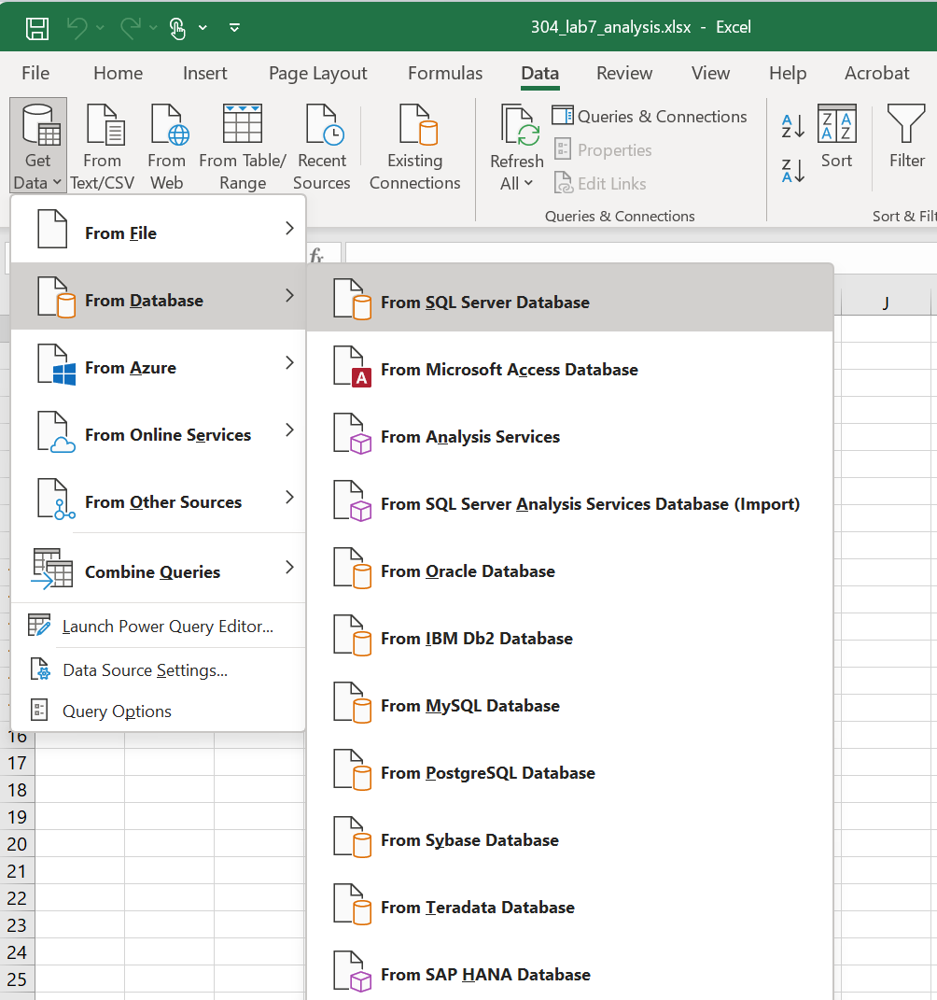
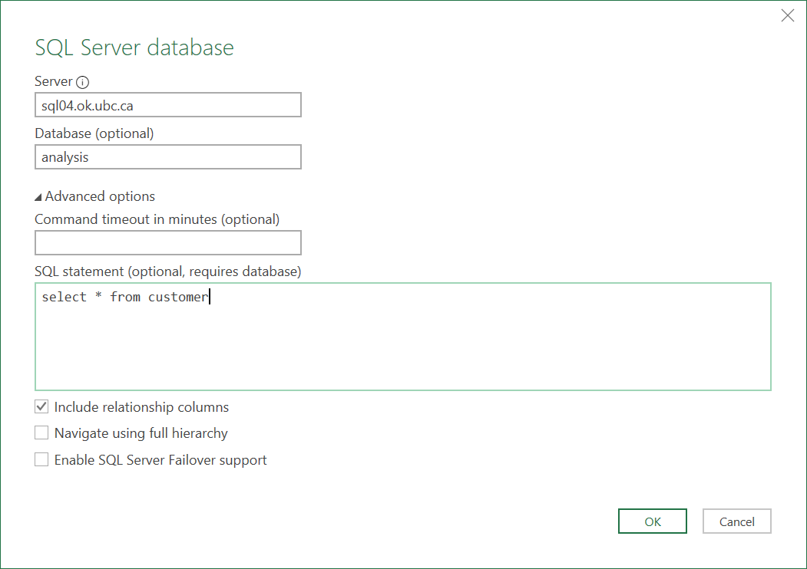
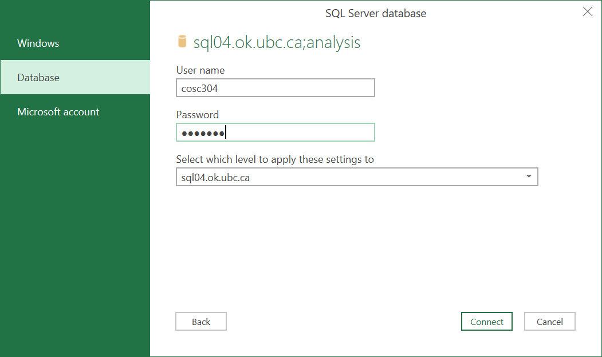
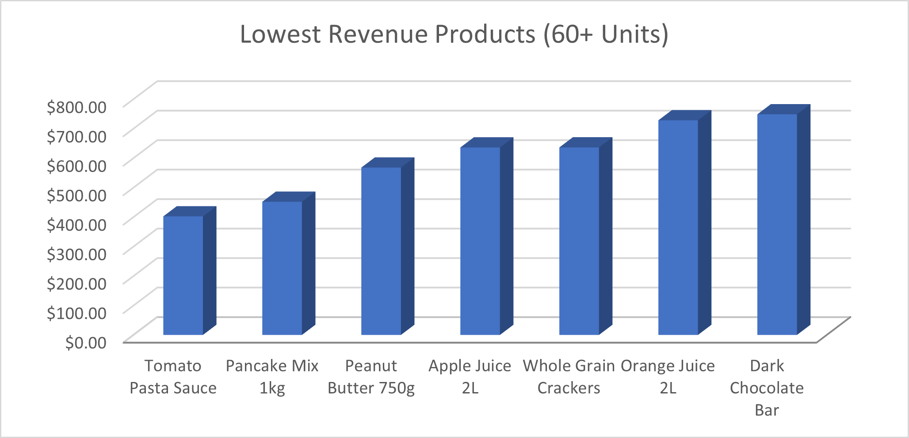
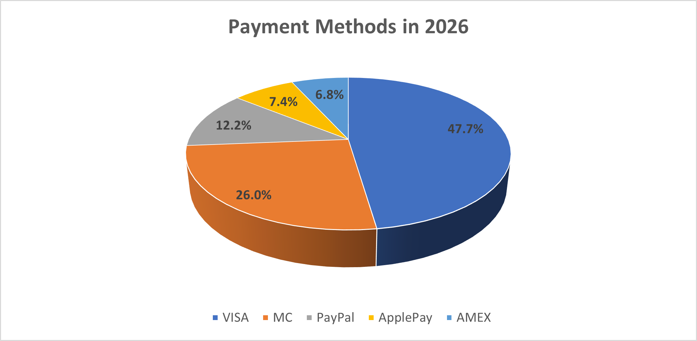
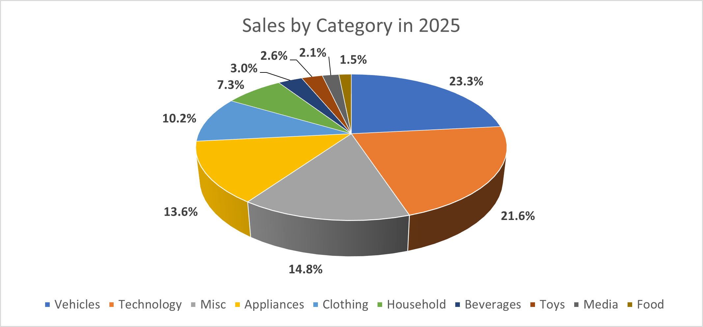
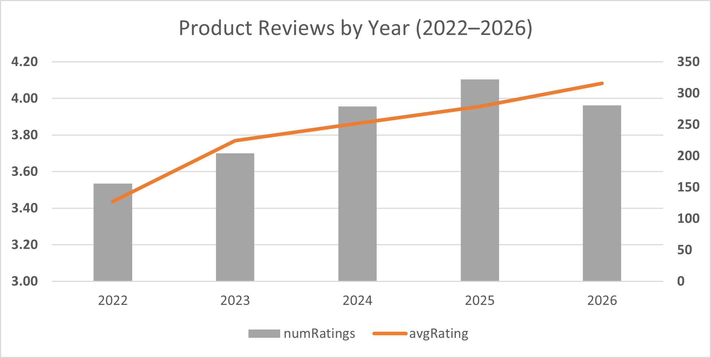

# COSC 304 - Introduction to Database Systems<br>Lab 7 - Using Databases with Analysis Software (Excel)

You have just been hired as the first data analyst at the ACME company. ACME has been selling products for many years and recording that information in a database. However, they have not been using that collected data to improve their business by tracking key customers and item sales volume, and modifying their pricing and distribution strategies. Your role is to provide these insights to management in a way that is easily understood.

## ACME Company Details

The ACME company sells all kinds of products. Every product has a given category, and customers are encouraged to review products.  Customers place orders through a website. Orders are shipped from one of three warehouses in Kelowna, Winnipeg, and Toronto. Each warehouse maintains inventory on its products. The company needs information on its top selling products, largest customers, and efficiency of its distribution system.

The ACME database is stored on Microsoft SQL Server. There are two options for connecting to the database.

**Option 1: Local SQL Server using Docker (recommended if you already have Docker installed)**

If you already have Docker installed and working, we encourage you to run SQL Server locally. The provided `docker-compose.yml` automatically starts SQL Server and loads the sample database from the DDL files in the `ddl` directory. From the directory containing `docker-compose.yml`, run:

```bash
docker compose up -d
```

Connect to the database using:

- **Server:** `localhost,1433`
- **Database:** `analysis`
- **User id:** `sa`
- **Password:** `304#sa#pw`

If using SQuirreL, the JDBC URL is `jdbc:sqlserver://localhost:1433;databaseName=analysis;trustServerCertificate=true`.

Stop SQL Server when finished using `docker compose down`. Your database will be preserved for the next time you start Docker.

**Option 2: Course SQL Server**

If you do not already have Docker working, you can use the shared course SQL Server. This database is read-only.

- **Server:** `cosc304.ok.ubc.ca`
- **Database:** `analysis`
- **User id and password:** Available on Canvas

If using SQuirreL, the JDBC URL is `jdbc:sqlserver://cosc304.ok.ubc.ca;databaseName=analysis;trustServerCertificate=true`.

To access the course server, you must be on campus connected to ubcsecure WiFi or connected to campus via VPN (`myvpn.ok.ubc.ca`).

## Part 1: Descriptive Analysis (20 marks)

The first step is to gather descriptive statistics from the company data. This will be done using SQL queries. The output of this analysis is a document containing each question, the SQL query, and the output table.

1. List the 10 lowest priced items (id, name, price). (1 mark)

| productId | productName          | productPrice |
| --------- | -------------------- | ------------ |
| 3         | Dark Chocolate Bar   | 3.99         |
| 11        | Whole Grain Crackers | 4.49         |
| 7         | Tomato Pasta Sauce   | 4.99         |
| 147       | Apple Juice 2L       | 5.99         |
| 6         | Pasta Variety Pack   | 6.49         |
| 146       | Orange Juice 2L      | 6.99         |
| 14        | Pancake Mix 1kg      | 7.49         |
| 1         | Maple Granola 500g   | 7.99         |
| 16        | Peanut Butter 750g   | 7.99         |
| 144       | Black Tea 30 Bags    | 7.99         |

2. Show the id, name, city, and state for the top 5 customers based on order total amount. (2 marks)

| customerId | firstName | lastName | city       | state | totalOrderAmount |
| ---------- | --------- | -------- | ---------- | ----- | ---------------- |
| 591        | Gabrielle | Brown    | Montreal   | QC    | 6455.44          |
| 317        | Zoe       | Martin   | Lethbridge | AB    | 6427.58          |
| 592        | Taylor    | Tremblay | Edmonton   | AB    | 5673.22          |
| 1004       | Alex      | Nguyen   | Vancouver  | BC    | 5330.27          |
| 1041       | Isabelle  | Clark    | Kelowna    | BC    | 5069.25          |

3. List the top 10 ordered products by total quantity (id, name, total quantity) in 2026. (2 marks)

| productId | productName                | totalQuantity |
| --------- | -------------------------- | ------------- |
| 145       | Sparkling Water 12 Pack    | 109           |
| 160       | Decaf Coffee Beans 500g    | 82            |
| 5         | Almond Butter 500g         | 69            |
| 120       | Mini Portable Projector    | 67            |
| 159       | Mineral Water 24 Pack      | 64            |
| 144       | Black Tea 30 Bags          | 62            |
| 143       | Green Tea 30 Bags          | 59            |
| 142       | Whole Bean Coffee 1kg      | 58            |
| 101       | Wireless Bluetooth Earbuds | 57            |
| 121       | Camping Tent 4 Person      | 56            |

4. List the bottom 7 ordered products (id, name, total revenue) that have generated the least amount of revenue. Only show products that have had a total quantity ordered of at least 60. (3 marks)

| productId | productName          | totalRevenue |
| --------- | -------------------- | ------------ |
| 7         | Tomato Pasta Sauce   | 402.17       |
| 14        | Pancake Mix 1kg      | 451.67       |
| 16        | Peanut Butter 750g   | 567.68       |
| 147       | Apple Juice 2L       | 635.81       |
| 11        | Whole Grain Crackers | 636.03       |
| 146       | Orange Juice 2L      | 727.99       |
| 3         | Dark Chocolate Bar   | 748.30       |


5. List the customer (id, names, average rating) who gives the highest average review rating considering all of their reviews. (3 marks)

| customerId | firstName | lastName | avgRating |
| ---------- | --------- | -------- | --------- |
| 6          | Nathan    | Murphy   | 5         |


6. Show the payment types based on total order amount by year. Only show years 2022 to current. An order must be shipped to be counted for a payment. Order by year ascending and total payment amount descending. (3 marks)

| orderYear | paymentType | totalPaymentAmount |
| --- | --- | --- |
| 2022 | VISA | 89,891.69 |
| 2022 | MC | 46,337.05 |
| 2022 | PayPal | 24,807.62 |
| 2022 | ApplePay | 14,934.32 |
| 2022 | AMEX | 8,480.10 |
| 2023 | VISA | 103,948.46 |
| 2023 | MC | 65,385.57 |
| 2023 | PayPal | 28,573.14 |
| 2023 | ApplePay | 21,897.05 |
| 2023 | AMEX | 13,181.01 |
| 2024 | VISA | 147,144.94 |
| 2024 | MC | 72,248.00 |
| 2024 | PayPal | 35,574.86 |
| 2024 | ApplePay | 26,263.04 |
| 2024 | AMEX | 14,537.71 |
| 2025 | VISA | 172,435.11 |
| 2025 | MC | 105,623.91 |
| 2025 | PayPal | 44,981.00 |
| 2025 | ApplePay | 28,445.25 |
| 2025 | AMEX | 17,087.65 |
| 2026 | VISA | 150,800.90 |
| 2026 | MC | 82,324.20 |
| 2026 | PayPal | 38,441.16 |
| 2026 | ApplePay | 23,371.31 |
| 2026 | AMEX | 21,395.68 |

7. Show the top 5 products (id, name, total quantity difference) that are shipped more frequently from the Kelowna warehouse compared to the Toronto warehouse. Hint: Subqueries may be useful. (3 marks)

| productId | productName           | quantityDiff |
| --------- | --------------------- | ------------ |
| 121       | Camping Tent 4 Person | 125          |
| 125       | Trekking Pole Pair    | 98           |
| 124       | Camping Cooking Stove | 88           |
| 122       | Hiking Backpack 35L   | 87           |
| 45        | Safety Bicycle Helmet | 55           |


8. Show the top 20 products that have the highest current inventory based on its sales for 2025. Calculate this as a ratio. For example, if the inventory of product X is currently 100, and the sales volume for product X in 2025 is 10, then the inventory ratio is 100/10 = 10. If a product has no sales in 2025, it should be in the list with a sales ratio of 9999. You may want to use the [SQLServer ISNULL() function](https://learn.microsoft.com/en-us/sql/t-sql/functions/isnull-transact-sql?view=sql-server-ver16). (3 marks)

| productId | totalInventory | totalSold | inventoryRatio |
| --------- | -------------- | --------- | -------------- |
| 20        | 456            | null      | 9999           |
| 39        | 333            | null      | 9999           |
| 60        | 394            | null      | 9999           |
| 80        | 277            | null      | 9999           |
| 100       | 381            | null      | 9999           |
| 119       | 423            | null      | 9999           |
| 140       | 316            | null      | 9999           |
| 160       | 388            | null      | 9999           |
| 180       | 197            | null      | 9999           |
| 200       | 197            | null      | 9999           |
| 36        | 61             | 2         | 30             |
| 178       | 288            | 10        | 28             |
| 139       | 205            | 9         | 22             |
| 58        | 242            | 12        | 20             |
| 77        | 220            | 14        | 15             |
| 99        | 156            | 12        | 13             |
| 17        | 280            | 23        | 12             |
| 34        | 234            | 23        | 10             |
| 198       | 185            | 17        | 10             |
| 54        | 51             | 6         | 8              |

## Part 2: Data Visualization (20 marks)

Analyzing data is easier using visualizations. The next step is to visualize data using Excel.

### Connecting Excel and SQL Server

To read data into Excel from SQL Server, follow these steps:

1) Open Excel. Under the `Data` Menu, select `Get Data` then, `From Database`, then `From SQL Server Database`.



2) Enter the server name based on your database setup:

- **Local Docker SQL Server:** `localhost,1433`
- **Course SQL Server:** `cosc304.ok.ubc.ca`

Enter `analysis` for the database. Select `Advanced options` and enter the SQL query that you want to perform. Click `OK`.



3) For authentication, select `Database` authentication. Use the following credentials:

- **Local Docker SQL Server:** User id `sa`, password `304#sa#pw`.
- **Course SQL Server:** User id `cosc304`, password available on Canvas.

If prompted about trusting the SQL Server certificate, select the option to trust the server certificate.



4) Click the `Load` button to load the data into a worksheet.

### Visualizations

Create the following visualizations with one worksheet per visualization. Use the name of the worksheet given. List the SQL query performed under the chart. **2026 is a partial year through October 26.** **Chart images do NOT have to look exactly like the samples provided.**

1. Sheet: `worstproducts` Visualize query 4 from part 1 showing the bottom 7 ordered products using a 3D column chart. (5 marks)



2. Sheet: `paymentmethods` Use a pie chart to show the percentage payment volume (based on order total amount) by payment method in 2026. (Similar to Q6 in Part 1.) (5 marks)



3. Sheet: `categoryvolume` Use a pie chart to show the percentage of total sales revenue by product category in 2025. . (5 marks)



4. Sheet: `reviews` Use a combo chart to show the number of reviews performed per year (columns) and the average review rating in that year (as a line). (5 marks)



## Part 3: Bonus (up to 10 marks)

Create two more queries and visualizations in Excel for bonus marks (+5 bonus marks each). The query and visualization should have complexity similar to the previous questions. The TAs will decide if the query has sufficient complexity. Try to create visualizations that are unique, interesting and would be valuable to the company.


# Submission

Submit your document for Part 1 and your Excel file for Part 2 on Canvas. Bonus marks are available for early review by the TA in a virtual office hours.
