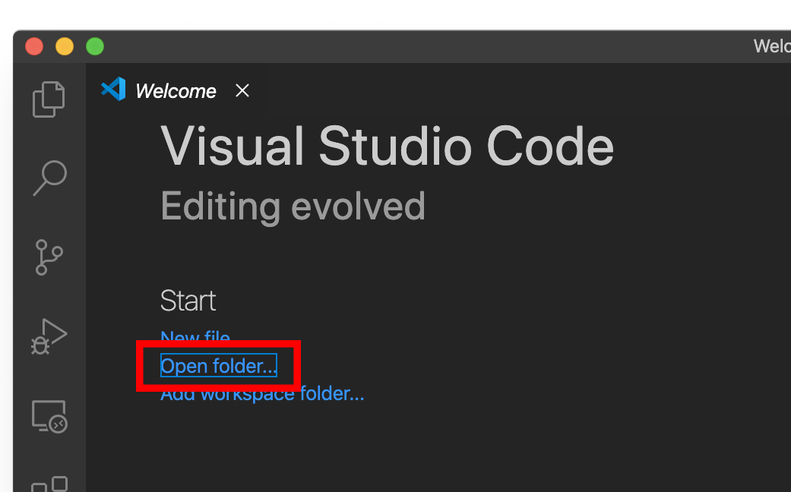
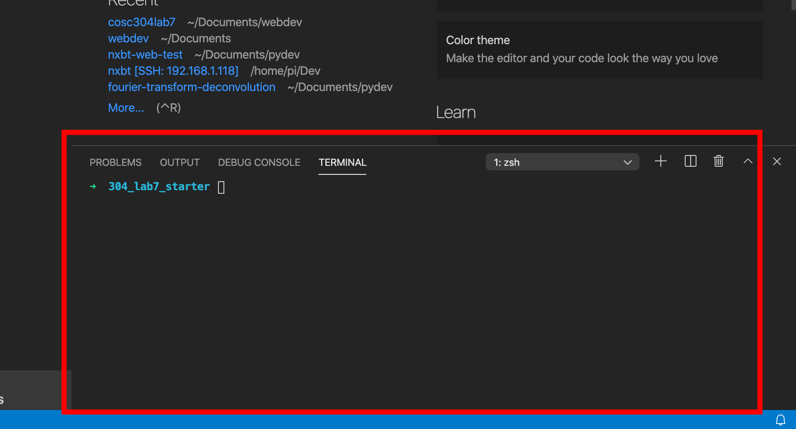

# COSC 304 - Introduction to Database Systems<br>Assignment 7 - Local Setup

This will setup a development environment using Docker on your computer.

## Steps

1. Install a text editor. It's highly recommended that you use VSCode ([Download Here](https://code.visualstudio.com/Download)) for this assignment due to the features it provides.

2. Once you've downloaded and installed your preferred text editor, extract the starter code for this project to a conveniently accessible area and open the folder in your text editor of choice. If you are using VSCode, click the "Open Folder" button and choose the folder containing the extracted starter code.



3. Download and install Docker ([here](https://www.docker.com/products/docker-desktop)). This is necessary for running the web application and a Microsoft SQL server instance.

4. Open a command line window and navigate to the directory of your starter code. If you are using VSCode, you can do this by pressing Ctrl + \`. If you are not using VSCode, you can use your system's terminal. On Windows, this would be `cmd.exe` and on MacOS, this would be `terminal.app`. The image below shows an instance of VSCode with the terminal open.



5. Useful Docker commands:

    ```
    # Start
    docker compose up -d
    
    # Check the running containers
    docker compose ps
    
    # Inspect errors
    docker compose logs -f
    
    # Stop, preserving containers
    docker compose stop
    
    # Stop and remove containers/networks
    docker compose down
    ```

    This will setup the JSP runtime and Microsoft SQL Server on your system. **If you have issues running Microsoft SQL Server on your machine, please contact the instructor for access to the cosc304 server.**

6. Open your preferred web browser and navigate to the following URL: [http://127.0.0.1/shop/shop.html](http://127.0.0.1/shop/shop.html). If all went well with the above steps, you should see the shop opening page.

7. Edit the files in the text editor and save them on your computer. Changes to these files should be reflected on the website.

