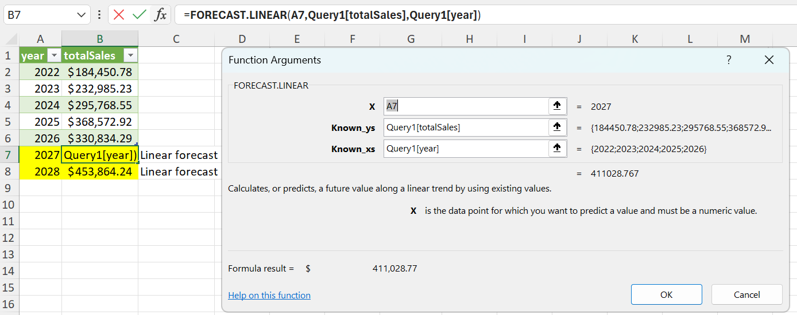
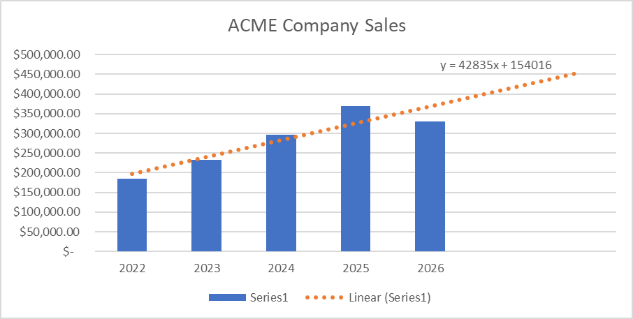
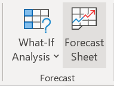
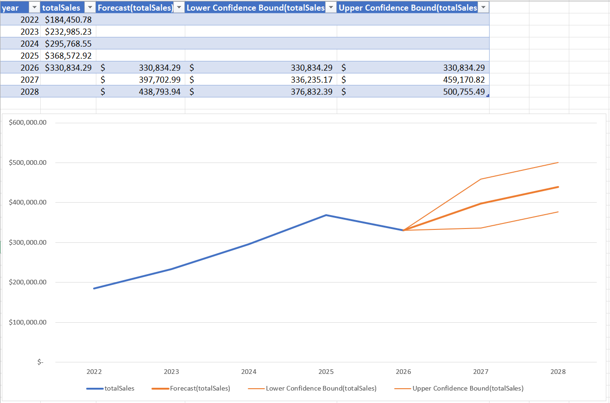
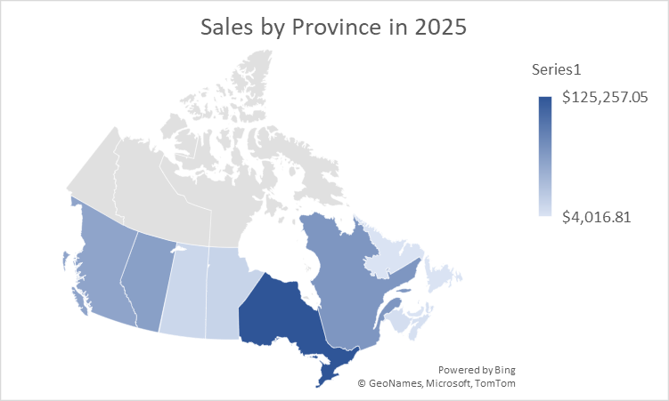

# COSC 304 - Introduction to Database Systems  
## Lab 8 - Data Prediction, Forecasting, and Visualization

## ACME Company Goals

In Lab 7, you analyzed ACME Company's historical orders, customers, and products. Management would now like to use that data to estimate future sales and identify products and regions that may perform well in the coming year.

In this lab, you will use SQL to extract historical data and Excel to perform predictions and create visualizations. **The goal is to explain a reasonable forecasting approach, not to produce a perfectly accurate prediction.** A forecast is only as reliable as the data and assumptions used to create it.

The database contains orders from **2022 through October 26, 2026**. **2026 is an incomplete year**, so be careful when comparing its sales with earlier years or using it to forecast future sales.

**Deliverable:** Submit a single Excel workbook named `304_lab8_analysis.xlsx`, containing the required tables, formulas, charts, explanations, and SQL queries. Use the worksheet names specified below. The lab is worth **25 marks**.

### Connecting to SQL Server and Excel

Use the same **`analysis` database** and connection setup as Lab 7:

- **Local Docker SQL Server:** Server `localhost`, database `analysis`, user `sa`, password `304#sa#pw`.
- **Course SQL Server:** Server `cosc304.ok.ubc.ca`, database `analysis`, credentials from Canvas. You must be on campus or connected through UBC VPN.

See the [Lab 7 analysis instructions](../../lab7/analyze/README.md#connecting-excel-and-sql-server) for detailed steps for Excel on Windows and on Mac.

You may connect Excel directly to SQL Server **or** run the SQL queries in SQuirreL SQL and import the results into Excel as CSV/Excel files. Both methods are acceptable. Include the SQL used to produce each dataset in your workbook.

## Prediction and Forecasting (25 marks)

### Question 1: Predicting Company Sales (10 marks)

ACME wants to forecast total sales revenue for **2027 and 2028**. First, produce a forecast using the historical data as recorded. Then improve the forecast by accounting for the incomplete 2026 data.

**Step 1: Retrieve annual sales.** Run the following query and import the results into a worksheet named **`salesdata`**.

```sql
SELECT YEAR(orderDate) AS year, SUM(totalAmount) AS totalSales
FROM ordersummary
GROUP BY YEAR(orderDate)
ORDER BY YEAR(orderDate);
```

You should obtain one row per year, from 2022 to 2026.

**Step 2: Initial prediction (5 marks).** Create a worksheet named **`initialpredict`** with the following:

1. The historical annual sales data (2022–2026), including the *unadjusted* 2026 total.
2. Predictions of annual sales in **2027 and 2028** using Excel's [`FORECAST.LINEAR`](https://support.microsoft.com/en-us/office/forecast-and-forecast-linear-functions-50ca49c9-7b40-4892-94e4-7ad38bbeda99) function. For example, if the years are in `salesdata!A2:A6` and totals in `salesdata!B2:B6`, use:

   ```excel
   =FORECAST.LINEAR(2027,salesdata!$B$2:$B$6,salesdata!$A$2:$A$6)
   ```



3.Create a column chart of historical sales using the year as the X-axis and sales revenue as the Y-axis. Add a linear trendline extended two years into the future. Compare its predictions for 2027 and 2028 with the results from `FORECAST.LINEAR`. The two methods should give essentially the same results apart from rounding.



4. One or two sentences explaining why the prediction may be misleading.

**Optional forecasting method:** Excel for Windows also offers **Data > Forecast Sheet**, which uses a different forecasting method. You may include its 2027–2028 predictions for comparison. The automatic Forecast Sheet command is not available in Excel for Mac, so it is **not required**.



Example of Excel's optional Forecast Sheet, which uses a different forecasting method and may produce different predictions from FORECAST.LINEAR. See Microsoft's [forecasting walkthrough for Excel for Windows](https://support.microsoft.com/en-us/office/create-a-forecast-in-excel-for-windows-22c500da-6da7-45e5-bfdc-60a7062329fd).



**Step 3: Updated prediction (5 marks).** The recorded 2026 total includes orders only through October 26. Make a second prediction using these assumptions:

1. Keep the recorded annual sales totals for **2022–2025** unchanged.
2. Estimate **full-year 2026 sales by increasing its recorded total by 20%**. This is a simple assumption, not a guaranteed adjustment; actual sales may be affected by seasonality.
3. Use the adjusted 2026 value to calculate updated forecasts for **2027 and 2028**.

Put the adjusted data, prediction formulas, and updated chart on a worksheet named **`salesprediction`**. Include a small comparison of your initial and adjusted forecasts and briefly explain how and why they differ.

### Question 2: Predicting Sales by Province (5 marks)

ACME wants to know which Canadian province is likely to have the highest sales revenue in **2027 and 2028**.

1. Write a SQL query showing **annual sales revenue by customer province** for the years **2022–2026**. Use the customer's province (`state` in the database). Include the year, province, and total sales revenue.
2. Use the historical data to predict sales revenue by province for **2027 and 2028**. Because 2026 is incomplete, either adjust it appropriately or omit it from the historical data used for prediction. Briefly describe your choice. Identify the province with the largest predicted sales in each forecast year.
3. Create an Excel **filled map chart** showing actual total sales revenue by province for **2025**, the last complete year in the dataset. A map chart can be inserted using **Insert > Maps > Filled Map**. If Excel does not recognize two-letter province codes, use full province names and include a separate country column containing `Canada`.

Place your query, data table, prediction results, map chart, and brief explanation in a worksheet named **`regionsales`**.

See Microsoft's [instructions for map charts in Excel](https://support.microsoft.com/en-us/office/create-a-map-chart-in-excel-f2cfed55-d622-42cd-8ec9-ec8a358b593b). Creating a map chart requires an internet connection. If the map feature is unavailable, create a bar chart comparing provincial sales and note the limitation.



### Question 3: Predicting Top Product Sales (10 marks)

ACME wants to predict its **top three products by sales revenue in 2027**, using historical orders from **2022–2026**. Sales revenue is the sum of **quantity × price** for ordered products. It is not the same as the number of units sold.

This is an open-ended question. There are approximately 200 products to consider, and there are several reasonable ways to forecast revenue. You may use SQL and Excel, and optionally Java or Python. Consider how to handle products that have little or no historical sales and how to account for the incomplete 2026 data.

Put the analysis in a worksheet named **`productsales`**, including the SQL query, historical data or summary, calculations, visualization, and predicted top three products. Provide the following:

1. A short paragraph describing and justifying your forecasting approach. **(2 marks)**
2. An implementation of your approach using SQL and Excel, with Java/Python if useful. Show enough calculations or formulas to explain how you obtained your predictions. **(5 marks)**
3. A list of sources used to design or implement your approach, including websites and any AI tools or conversations. If none were used, state that. **(2 marks)**
4. Your predicted **top three products for 2027**, with their names and predicted sales revenue (in dollars). **(1 mark)**

**Generative AI is allowed for this question.** You remain responsible for checking all SQL, formulas, assumptions, and results. Document any AI assistance in your workbook.

## Submission

Submit **one Excel workbook** named `304_lab8_analysis.xlsx` on Canvas. It should contain these five worksheets:

- `salesdata` — annual sales data retrieved from SQL Server
- `initialpredict` — initial 2027–2028 forecasts and chart
- `salesprediction` — updated forecasts using adjusted 2026 sales
- `regionsales` — province-level predictions and map (or fallback) chart
- `productsales` — product revenue forecasting and predicted top three products

Make sure the SQL queries, formulas, charts, written explanations, and source/AI acknowledgments are included in the workbook. The same marking criteria apply whether data was imported directly from SQL Server or exported from SQuirreL SQL.

Bonus marks are available for early review by the TA during virtual office hours, as described in the course schedule on Canvas.

