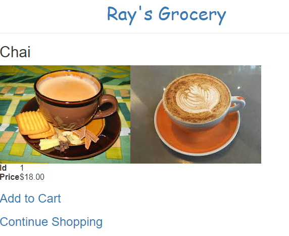
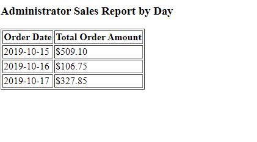
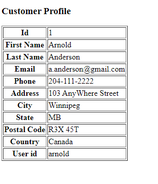
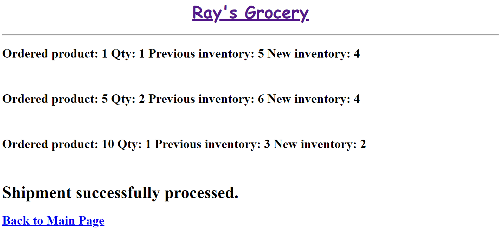
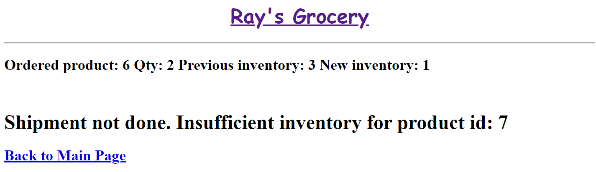

# COSC 304 - Introduction to Database Systems Lab 8: Images, Security, and Transactions

Modify your existing project web site with new features including a product detail page, a login feature, an administrator page, and support for transactions.

## Project Requirements (25 marks)

1. [Sample web site](https://cosc304.ok.ubc.ca/rlawrenc/tomcat/lab8/index.jsp)

2. Start with the setup for lab 7 for either [Java](https://github.com/rlawrenc/cosc_304/tree/main/labs/lab7/java), [Python](https://github.com/rlawrenc/cosc_304/tree/main/labs/lab7/python), or [Node.js](https://github.com/rlawrenc/cosc_304/tree/main/labs/lab7/nodejs). **If you have an existing Docker container for lab 7, you do not need to download and setup lab 7 again.**

3. Download starter code for [Java](304_lab8_java_starter.zip), [Python](304_lab8_python_starter.zip), or [Node.js](304_lab8_node_starter.zip). Extract the files into your existing Lab 7 project and follow the README included in the ZIP. Some files, including the main page, will be replaced. Preserve any custom changes you made in Lab 7. Complete the TODOs in the new files and modify your existing product listing page to link to the product details.

4. Your output does not have to look exactly like the sample (feel free to make it look better!).

The product page will show details on the product including images. An image can be retrieved from a local folder using a URL or stored as a binary object in the database.

#### Marking Guide (product page): (10 marks)

- **+1 mark** - for modifying product listing page to go to product detail page when click on product name
- **+3 marks** - Retrieve and display product information by ID using a parameterized SQL query (e.g., PreparedStatement in Java).
- **+2 marks** - for displaying an image using an HTML `img` tag based on `productImageURL` field
- **+3 marks** - for displaying an image from the binary field `productImage` by providing an `img` tag and modifying the `displayImage` server-side code.
- **+1 mark** - for adding two links: "Add to Cart" link should use the product's actual ID, name, and price, and "Continue Shopping" link should return to the product listing.

#### Screenshot

#### Marking Guide (admin and login page): (5 marks)

- **+2 marks** - Validate the user ID and password against the database using a parameterized query, and store the logged-in user in the session.
- **+3 marks** - Display a daily sales report showing total sales for each day, ordered by date, using SQL aggregation. The report must require the user to be logged in.

#### Screenshot

#### Marking Guide (customer page): (5 marks)

The customer page displays the currently logged-in customer's information.

- **+4 marks** - Retrieve and display the currently logged-in customer's information using a parameterized SQL query.
- **+1 mark** - Handle missing customer information appropriately and ensure that users cannot access another customer's information by modifying the URL.

#### Screenshot

#### Marking Guide (shipment page): (5 marks)

- **+3 marks** - Use a database transaction to process all products in an order. Create a shipment record for warehouse 1 and update inventory for all ordered products. If all operations succeed, commit the transaction; otherwise roll back all changes.
- **+2 marks** - Verify that warehouse 1 has sufficient inventory for each product and its ordered quantity. If any product has insufficient inventory, display an error and roll back the entire transaction, including any previous inventory updates and the shipment record.

Test both a successful and an unsuccessful shipment. Verify that inventory is updated only when the entire transaction succeeds. You may need to reload the database if you test the same order multiple times.

Example test URLs:
- Java: `http://localhost/shop/ship.jsp?orderId=1`
- Python/Node.js: `http://localhost/ship?orderId=1`

Use `orderId=3` to test an unsuccessful shipment with insufficient inventory.

#### Screenshot - Successful Shipment with orderId=1

#### Screenshot - Unsuccessful Shipment with orderId=3

# Submission

Demonstrate your working Lab 8 application to a TA during virtual office hours. If you do not demonstrate live, submit your updated source code and a short video demonstrating the new features on Canvas.

You do not need to submit Docker containers, database files, or installed dependencies. Bonus marks are available for early completion.
